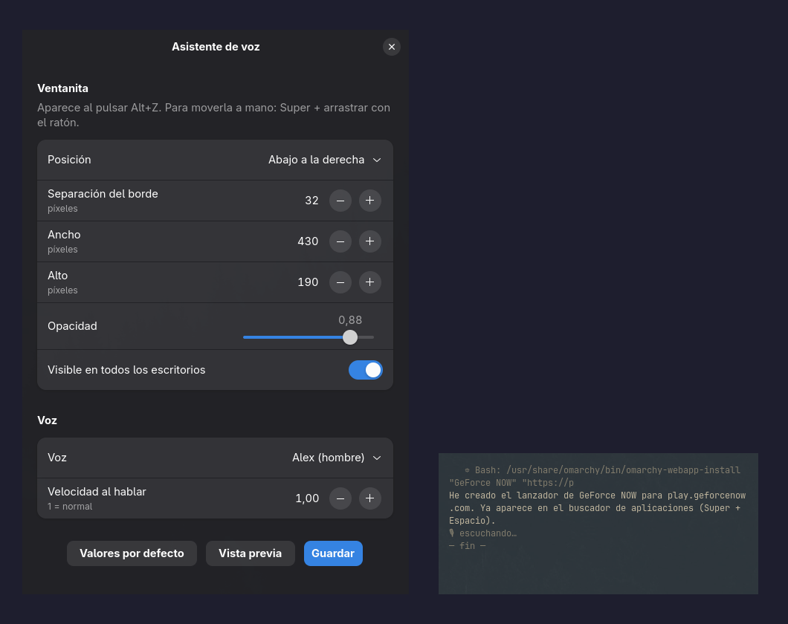

# voz-es

Asistente de voz en español para Omarchy (Hyprland): pulsa Alt+Z, habla y te contesta mientras controla el escritorio.

Whisper large-v3-turbo (oído, local) → reglas locales para órdenes habituales → `claude -p --model haiku` para el resto → Kokoro-82M (voz, local).

- `asistente.py`: el servicio de Alt+Z (`sistema/systemd/voz-es.service`).
- `ajustes.py`: app «Asistente de voz» (GTK4 + libadwaita) para posición, tamaño, opacidad y voz de la ventanita.
- `app.py`: versión web local (127.0.0.1:7861) con LFM2.5-1.2B.
- `sistema/`: scripts de `~/.local/bin`, regla y atajo de Hyprland, entrada del lanzador.

Python 3.12.15 con uv (`exclude-newer`), PyTorch cu126 (GTX 1070). Instalar: `uv sync`.
